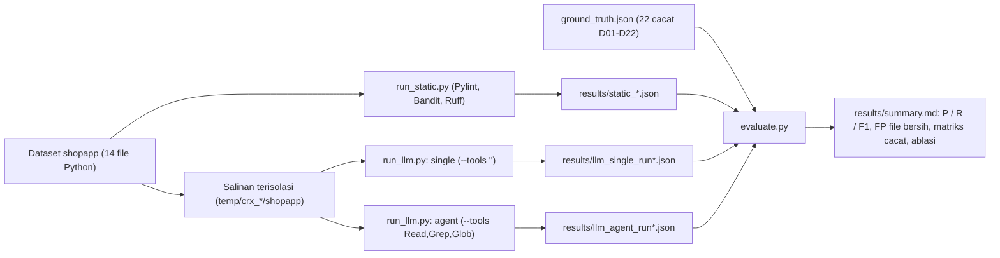

# Dokumentasi Proyek UAS: Code Review Agent AI

Dokumentasi teknis eksperimen yang membandingkan **alat analisis statis**, **LLM single-shot**, dan **code review agent** pada proyek Python `shopapp` (14 file, 22 cacat tertanam).

## Peta dokumen

| Dokumen | Isi utama |
| --- | --- |
| [Laporan utama (SLR + eksperimen)](https://claude.ai/artifact/M38jm8zUPu5xzzmLaeQjN4) | Naskah lengkap: pendahuluan, landasan teori, SLR 29 studi, desain dan hasil eksperimen, pembahasan, kesimpulan, daftar pustaka, lampiran kode dan prompt. Bisa diekspor ke Word/PDF dari halaman dokumen. |
| [01 — Arsitektur dan kode](01-arsitektur-dan-kode.md) | Isolasi workspace `crx_*`, fungsi di `common.py`, `run_static.py`, `run_llm.py`, `evaluate.py`, skema JSON |
| [02 — Dataset dan ground truth](02-spesifikasi-dataset-ground-truth.md) | 14 file `shopapp` (290 baris), 22 cacat `D01`–`D22`, 2 file kontrol bersih |
| [03 — Panduan reproduksi](03-panduan-reproduksi.md) | Prasyarat, instalasi, perintah langkah demi langkah, penanganan limit kuota |
| [04 — Log hasil dan ablasi](04-log-hasil-dan-ablasi.md) | Semua tabel metrik, log per file (14 file × 3 run × 2 kondisi), contoh TP/FP |
| [Ringkasan folder eksperimen](../eksperimen/README.md) | Struktur file di `eksperimen/` |
| [Prompt agent](../eksperimen/prompts/agent.txt) · [Prompt single-shot](../eksperimen/prompts/single_shot.txt) | Teks prompt persis seperti yang dikirim ke model |

## Hasil singkat

| Metode | Precision | Recall | F1 | Biaya per run (USD) |
| --- | ---: | ---: | ---: | ---: |
| Statis gabungan (Pylint + Bandit + Ruff) | 0,900 | 0,409 | 0,563 | 0 |
| LLM single-shot (rata-rata 3 run) | 0,309 ± 0,022 | 1,000 | 0,472 ± 0,026 | 0,144 |
| Code review agent (rata-rata 3 run) | 0,419 ± 0,032 | 1,000 | 0,590 ± 0,032 | 4,103 |

## Alur kerja eksperimen



## Struktur repositori

```text
uas/
├── docs/
│   ├── README.md
│   ├── 01-arsitektur-dan-kode.md
│   ├── 02-spesifikasi-dataset-ground-truth.md
│   ├── 03-panduan-reproduksi.md
│   └── 04-log-hasil-dan-ablasi.md
└── eksperimen/
    ├── README.md
    ├── common.py
    ├── ground_truth.json
    ├── run_static.py
    ├── run_llm.py
    ├── evaluate.py
    ├── results_llm_log.txt          # log eksekusi pertama
    ├── results_llm_retry_log.txt    # log pengulangan file yang gagal kuota
    ├── dataset/shopapp/             # 14 file Python (290 baris)
    ├── prompts/
    │   ├── single_shot.txt
    │   └── agent.txt
    └── results/                     # 9 JSON mentah + summary.md
```
